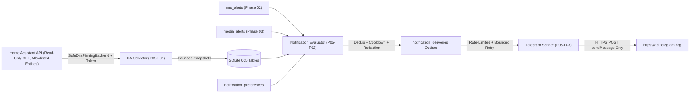

# Phase 05 — Gate 0 Architecture & Security Design

**Status:** GATE 0 DESIGN ONLY (Awaiting Human Review — No Implementation Authorized)  
**Branch:** `feature/phase-05-home-assistant-telegram`  
**Draft PR:** #5  
**Baseline:** Phase 04 merged into `main` at `28c11aab1a65c24db22946d12663cbdae0b602c0`  

---

## 1. Live Code Inventory & Reuse Map

Inspection of the current repository confirms substantial hardened infrastructure from Phases 01–04 that Phase 05 will **reuse directly** rather than duplicate:

| Existing Module / File | Current Capability | Phase 05 Reuse Strategy |
|---|---|---|
| [`scheduler.py`](file:///home/antigravity/Tb3c123/HomeAgentP/apps/core/src/homeagentp_core/scheduler.py) (`HardenedPeriodicScheduler`) | Non-overlapping asyncio background loop, per-cycle timeout, graceful shutdown, throttled persistence. | Subclass for `HomeAssistantCollectionScheduler` and `NotificationDeliveryScheduler`. |
| [`modules/media/security.py`](file:///home/antigravity/Tb3c123/HomeAgentP/apps/core/src/homeagentp_core/modules/media/security.py) & [`http_client.py`](file:///home/antigravity/Tb3c123/HomeAgentP/apps/core/src/homeagentp_core/modules/media/http_client.py) | `SafeDnsPinningBackend`, `resolve_and_validate_host`, `_validate_ip_object`, `validate_service_url`, `follow_redirects=False`, bounded response reads. | Extract/share into a common `net/safe_http.py` (with compatibility re-exports in `modules/media/`) for both Home Assistant and Telegram outbound HTTP clients. |
| [`modules/nas/collector.py`](file:///home/antigravity/Tb3c123/HomeAgentP/apps/core/src/homeagentp_core/modules/nas/collector.py) & `002_nas_guardian.sql` (`nas_alerts`) | Active/resolved alert lifecycle (`alert_key`, `severity`, `status`, `first_seen_at`, `last_seen_at`, `resolved_at`, `occurrences`). | Read `nas_alerts` state transitions as notification inputs without modifying `nas_alerts` schema or NAS collector behavior. |
| [`modules/media/alerts.py`](file:///home/antigravity/Tb3c123/HomeAgentP/apps/core/src/homeagentp_core/modules/media/alerts.py) & `003_media_downloads.sql` (`media_alerts`) | Active/resolved media alert lifecycle with consecutive-failure thresholds. | Read `media_alerts` state transitions as notification inputs without modifying `media_alerts` schema or Media collector behavior. |
| [`auth/security.py`](file:///home/antigravity/Tb3c123/HomeAgentP/apps/core/src/homeagentp_core/auth/security.py) & [`modules/workspace/security.py`](file:///home/antigravity/Tb3c123/HomeAgentP/apps/core/src/homeagentp_core/modules/workspace/security.py) | Session cookie auth, CSRF (`X-CSRF-Token`), `require_workspace_owner` RBAC, `redact_secrets` log filter, `audit_logs` table. | Reuse `get_current_principal` for reads, promote/share `require_owner` for owner-only mutations, and reuse `audit_logs` + secret redaction. |
| [`apps/web/src/components/sections/OverviewSection.tsx`](file:///home/antigravity/Tb3c123/HomeAgentP/apps/web/src/components/sections/OverviewSection.tsx) (`HomeAutomationSection`) | Placeholder tab wired into `App.tsx` (`activeSection === "home_automation"`). | Replace placeholder with modular `components/home_automation/` components and `useHomeAutomationData` hook while preserving `OverviewSection`. |

---

## 2. Data-Flow Architecture

- **Isolation invariant**: Unreachable Home Assistant or Telegram API endpoints must never block NAS Guardian polling, Media polling, `/api/v1/health`, or SQLite availability.

---

## 3. Opt-In Read-Only Home Assistant Integration (`P05-F01`)

- **Feature flags (default disabled)**:
  - `HOMEAGENTP_HA_ENABLED: bool = False`
  - `HOMEAGENTP_HA_SCHEDULER_ENABLED: bool = False`
  - When disabled, `GET /api/v1/home-assistant/overview` returns `status: "unavailable"`, `reason: "Home Assistant integration is disabled (opt-in)."`, and performs **zero** outbound network calls.
- **Authentication & Secret Handling**:
  - Uses a scoped Home Assistant Long-Lived Access Token via `HOMEAGENTP_HA_TOKEN` (runtime environment variable only).
  - Never stored in SQLite, Git, logs, API responses, or UI state.
- **Polling vs. WebSocket Decision**:
  - **Decision: Bounded HTTP REST polling** (`GET /api/` for health + `GET /api/states/{entity_id}` per allowlisted entity) rather than a persistent WebSocket subscription.
  - *Rationale*: REST polling fits `HardenedPeriodicScheduler`, avoids long-lived WS reconnect loops/unbounded event floods, and enforces strict per-entity allowlisting without fetching the entire HA `/api/states` dump.
- **Strict Entity Allowlist**:
  - `HOMEAGENTP_HA_ALLOWED_ENTITIES: list[str]` (default `[]`), validated against `^[a-z0-9_]+\.[a-z0-9_]+$`, capped at **25 entities max**.
  - Only explicitly allowlisted `entity_id` values are queried; all other entities are ignored.
- **Read-Only Enforcement**:
  - Only `GET` requests to `/api/` and `/api/states/{entity_id}` are permitted.
  - `/api/services/*` and all `POST`/`PUT`/`PATCH`/`DELETE` methods are structurally absent from the HA client.
- **SSRF, DNS Pinning & Bounds**:
  - URL validated against `HOMEAGENTP_HA_ALLOWED_HOSTS` (default `["127.0.0.1", "localhost", "::1"]`).
  - `SafeDnsPinningBackend` resolves DNS once, blocks unspecified/multicast/link-local/cloud-metadata (`169.254.0.0/16`, `fe80::/10`, IPv4-mapped IPv6), and pins the TCP connection to the validated IP.
  - `follow_redirects=False`, per-request timeout `5.0s`, cycle timeout `15.0s`, max response body `524_288` bytes (512 KiB).

---

## 4. Outbound-Only Telegram Notifications (`P05-F03`)

- **Feature flags (default disabled)**:
  - `HOMEAGENTP_TELEGRAM_ENABLED: bool = False`
  - `HOMEAGENTP_TELEGRAM_BOT_TOKEN: str = ""` (runtime secret only; never logged or persisted in SQLite).
  - `HOMEAGENTP_TELEGRAM_ALLOWED_CHAT_IDS: list[str] = []` (explicit integer/negative-group chat IDs, e.g., `^-?[0-9]{5,20}$`).
- **Outbound-Only Scope**:
  - Only calls `POST https://api.telegram.org/bot<token>/sendMessage` via `SafeDnsPinningBackend`.
  - **Strictly HTTPS-only** to `api.telegram.org` (public IPs only; private/loopback/link-local/metadata IPs blocked even if DNS is poisoned; `follow_redirects=False`).
  - **No** `getUpdates`, **no** webhook endpoints, **no** inbound bot commands, **no** remote shell or script execution.
- **Anti-Spam, Redaction & Bounded Retries**:
  - **Secret redaction**: All alert messages pass through `redact_secrets` *before* persisting to `notification_deliveries` and *before* transmission. Bot token is masked in all error strings (`bot***`).
  - **Message bounds**: Plain text (or safely escaped text without raw HTML injection), truncated to **2000 characters**.
  - **Deduplication & Cooldown**: Incident key `{source_domain}:{alert_key}:{event_type}` (`triggered` | `resolved`). Repeated triggers within `cooldown_seconds` (default `900s` / 15 min) are recorded as `suppressed_cooldown` without sending.
  - **Rate Limiting**: Sliding-window cap (default `10` messages per `300s`). Excess items are marked `suppressed_rate_limit` or deferred without unbounded queue growth.
  - **Bounded Retries**: Transient `429` (honoring `Retry-After` capped at `60s`) and `5xx`/network errors retry up to **3 attempts** with exponential backoff (`5s`, `15s`, `45s`). Permanent `4xx` (`400`/`401`/`403`/`404`) transition immediately to `dead_letter` with redacted error details—preventing retry storms.

---

## 5. Minimal Additive SQLite Schema (`005_home_assistant_telegram.sql`)

All Phase 05 tables are additive and leave `001`–`004` tables untouched:

1. **`ha_entity_states`**:
   - `entity_id TEXT PRIMARY KEY`, `domain TEXT NOT NULL`, `friendly_name TEXT NOT NULL DEFAULT ''`, `state TEXT NOT NULL`, `attributes_json TEXT NOT NULL DEFAULT '{}'`, `status TEXT NOT NULL CHECK (status IN ('online', 'stale', 'unavailable'))`, `last_changed TEXT`, `collected_at TEXT NOT NULL`.
2. **`ha_entity_snapshots`**:
   - `id INTEGER PRIMARY KEY AUTOINCREMENT`, `collected_at TEXT NOT NULL`, `overall_status TEXT NOT NULL`, `entity_count INTEGER NOT NULL DEFAULT 0`, `summary_json TEXT NOT NULL DEFAULT '{}'`. Bounded retention (latest 200 rows pruned on insert).
3. **`notification_preferences`**:
   - `id INTEGER PRIMARY KEY CHECK (id = 1)`, `telegram_enabled INTEGER NOT NULL DEFAULT 0`, `min_severity TEXT NOT NULL CHECK (min_severity IN ('warning', 'critical')) DEFAULT 'warning'`, `notify_on_resolve INTEGER NOT NULL DEFAULT 1`, `cooldown_seconds INTEGER NOT NULL DEFAULT 900`, `rate_limit_count INTEGER NOT NULL DEFAULT 10`, `rate_limit_window_seconds INTEGER NOT NULL DEFAULT 300`, `updated_by TEXT NOT NULL`, `updated_at TEXT NOT NULL`. *(Contains zero secrets or tokens.)*
4. **`notification_deliveries`**:
   - `id INTEGER PRIMARY KEY AUTOINCREMENT`, `incident_key TEXT NOT NULL`, `source_domain TEXT NOT NULL CHECK (source_domain IN ('nas', 'media', 'home_assistant', 'system'))`, `severity TEXT NOT NULL CHECK (severity IN ('info', 'warning', 'critical'))`, `channel TEXT NOT NULL CHECK (channel IN ('telegram'))`, `destination_masked TEXT NOT NULL`, `message_redacted TEXT NOT NULL`, `status TEXT NOT NULL CHECK (status IN ('pending', 'sent', 'suppressed_cooldown', 'suppressed_rate_limit', 'failed', 'dead_letter'))`, `attempt_count INTEGER NOT NULL DEFAULT 0`, `next_attempt_at TEXT`, `last_error_redacted TEXT NOT NULL DEFAULT ''`, `created_at TEXT NOT NULL`, `sent_at TEXT`. Bounded retention (latest 500 rows).

---

## 6. API Contracts, Authorization & CSRF

| Endpoint | Method | Auth / RBAC | CSRF | Purpose |
|---|---|---|---|---|
| `/api/v1/home-assistant/overview` | `GET` | Authenticated (`owner` or `viewer`) | No | Read HA status, allowlisted entity states, and staleness/unavailable reason. |
| `/api/v1/home-assistant/collect` | `POST` | `owner` only (`require_owner`) | Yes | Trigger bounded on-demand HA read-only poll (or return honest `unavailable` when disabled). |
| `/api/v1/notifications/preferences` | `GET` | Authenticated (`owner` or `viewer`) | No | Read current notification policy + masked destination count (never tokens). |
| `/api/v1/notifications/preferences` | `PUT` | `owner` only (`require_owner`) | Yes | Update cooldown, severity threshold, resolve-notification toggle, and rate limits; writes `audit_logs`. |
| `/api/v1/notifications/deliveries` | `GET` | Authenticated (`owner` or `viewer`) | No | Paginated (`limit`, `offset`) delivery & suppression history. |
| `/api/v1/notifications/test` | `POST` | `owner` only (`require_owner`) | Yes | Enqueue/send a single redacted test notification if Telegram is enabled + destination allowlisted; returns `503` if disabled. |

---

## 7. Security Threat Model

| Threat | Mitigation |
|---|---|
| **SSRF / DNS Rebinding via HA URL or Telegram URL** | Reuse `SafeDnsPinningBackend` (single DNS resolution pinned at TCP connect, `follow_redirects=False`, link-local/metadata/multicast blocked). Telegram locked to `https://api.telegram.org` public IP only. |
| **HA State Mutation / Unauthorized Device Control** | Only `GET /api/` and `GET /api/states/{entity_id}` exist in the HA adapter; `/api/services/*` is never called. |
| **Telegram Bot Token or HA Token Leakage** | Tokens accepted only via runtime env vars (`HOMEAGENTP_HA_TOKEN`, `HOMEAGENTP_TELEGRAM_BOT_TOKEN`), scrubbed from logs/errors/`notification_deliveries`, never persisted in SQLite or returned in API/UI. |
| **Telegram Inbound Command / Webhook Abuse** | Outbound `sendMessage` only; no `getUpdates` polling, no webhook endpoint. |
| **Alert Storm / HTTP 429 Retry Loop** | Per-incident cooldown (`900s`), sliding-window rate limit, max 3 retries with capped backoff, permanent `4xx` -> `dead_letter`, max outbox size `100`. |
| **Viewer Privilege Escalation / CSRF** | All mutations require `owner` role + valid `X-CSRF-Token`; viewer gets `403` and read-only UI. |
| **SQLite Unbounded Growth** | Retention pruning on `ha_entity_snapshots` (200) and `notification_deliveries` (500). |

---

## 8. Regression Test Matrix & Isolated Staging Plan

| Gate | Scope | Required Tests |
|---|---|---|
| **Gate A** | `P05-F01` + `P05-F02` | Migration `005` idempotency & restart persistence; disabled HA returns `unavailable` with 0 network calls; allowlisted `entity_id` enforcement & max 25 cap; SSRF/DNS-pinning/redirect rejection; `POST`/`service` call impossibility; notification evaluator dedup, cooldown, and secret redaction on NAS/Media/HA alerts; owner/viewer RBAC & CSRF. |
| **Gate B** | `P05-F03` + `P05-F04` | Telegram allowlisted `chat_id` enforcement; HTTPS-only `api.telegram.org` pinning; token masking in errors/logs; `429` `Retry-After` backoff & `4xx` dead-lettering; sliding-window rate limit; `NotificationDeliveryScheduler` non-overlapping execution, timeout, and graceful shutdown; partial outage isolation (HA/Telegram down does not affect NAS/Media). |
| **Gate C** | `P05-F05` + `P05-F06` | Frontend `HomeAutomationSection` Vitest suite (disabled/unavailable, online/stale, viewer read-only, preference update, delivery history pagination, error states); full `ruff`, `mypy`, `pytest`, `tsc`, `vitest`, `vite build`; GitHub Actions `Docker staging (isolated, no NAS)` with dummy tokens & mock/disabled endpoints. |

- **Rollback**: Migration `005` is strictly additive (`ha_*` and `notification_*` tables). Rolling back Phase 05 requires only reverting the branch/PR and setting `HOMEAGENTP_HA_ENABLED=false` and `HOMEAGENTP_TELEGRAM_ENABLED=false`; Phases 01–04 tables and routes remain intact.

---

## 9. Decisions Requiring Explicit Owner Approval Before Implementation / Live Use

1. **HA Entity Allowlist**: Confirm the exact initial `HOMEAGENTP_HA_ALLOWED_ENTITIES` list (e.g., UPS/power sensors, temperature, door/leak sensors) and confirm max 25 entities is sufficient.
2. **HA Transport on LAN**: Confirm whether local Home Assistant on the NAS LAN uses `http://` (requiring `HOMEAGENTP_HA_ALLOWED_HOSTS` LAN IP/hostname) or `https://` with a trusted/local cert.
3. **Telegram Destination Chat IDs**: Confirm the exact `HOMEAGENTP_TELEGRAM_ALLOWED_CHAT_IDS` and confirm outbound-only notifications (no interactive bot commands) is the desired Phase 05 scope.
4. **Cooldown & Severity Defaults**: Confirm default `min_severity="warning"`, `cooldown_seconds=900`, `rate_limit=10/300s`, and `notify_on_resolve=true`.
5. **Live Connection Gate**: Implementation of Gates A–C will use **mock HTTP transports and dummy credentials only**; a separate explicit owner authorization will be required before connecting to live Home Assistant, sending any real Telegram message, or deploying to the NAS.
